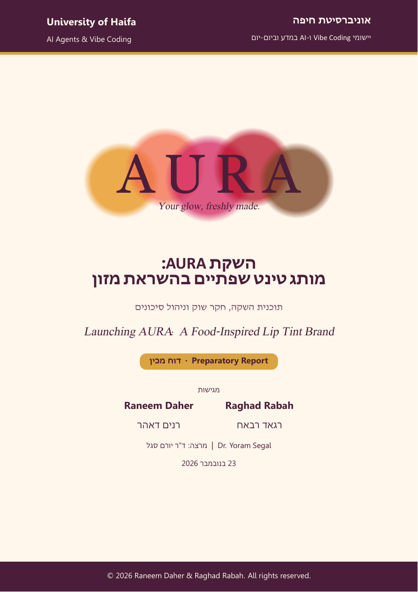
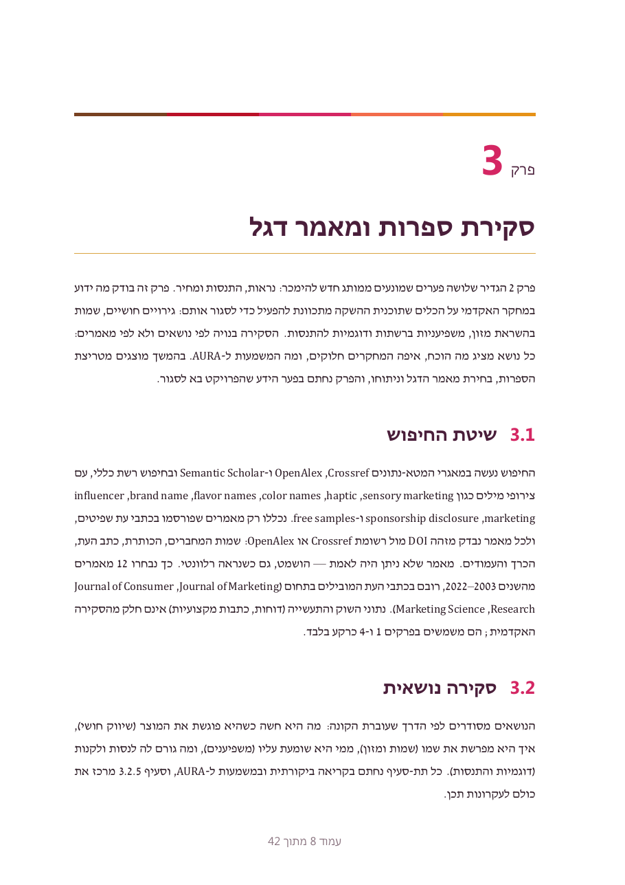
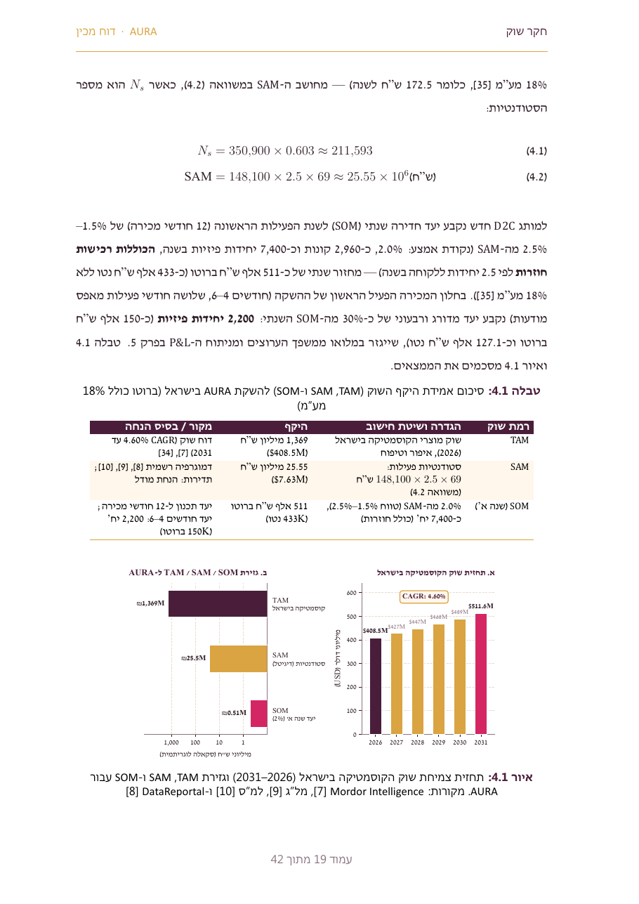
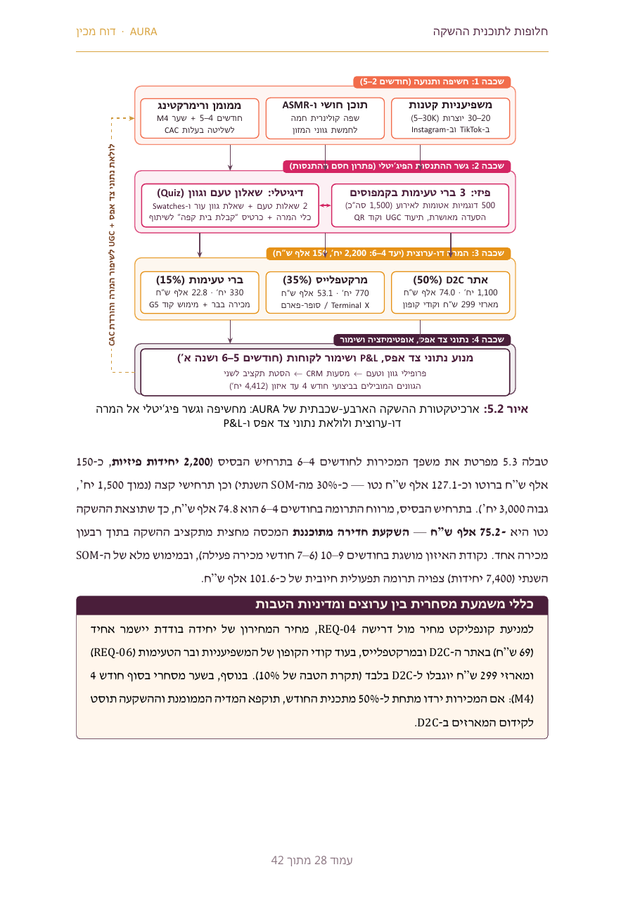
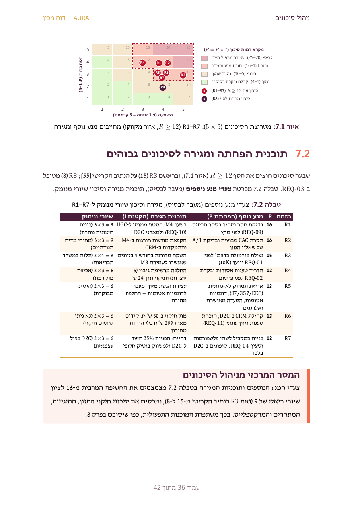

# AURA – Preparatory Report (Exercise 2)

## Final Submission

**Report (PDF):** [`report/rr-mkcom-ex02-report.pdf`](report/rr-mkcom-ex02-report.pdf)
· 49 pages: front matter (א–ו), body pp. 1–37, references pp. 38–42 (58 sources, IEEE)
· Git tag: `submission-ex02`

| | |
|---|---|
| **Course** | AI Agents & Vibe Coding (יישומי Vibe Coding ו-AI במדע וביום-יום) |
| **University** | University of Haifa |
| **Lecturer** | Dr. Yoram Segal |
| **Assignment** | Exercise 2 – Preparatory Report (דוח מכין) |
| **Team** | Raneem Daher (Claude Code) · Raghad Rabah (Antigravity) |

## The project in short

A preparatory report in Hebrew, written in XeLaTeX with our own document class, for the
6-month launch in Israel of **AURA**, the food-inspired lip tint brand from Exercise 1. The
structure follows the page map in the lecturer's booklet: front matter, 8 chapters and
references.

The report defines the problem (a new brand with zero awareness, in a category bought after
trial) and five SMART goals with 11 requirements. It reviews 12 peer-reviewed papers and a
flagship paper (Bawa & Shoemaker, 2004), sizes the market (TAM/SAM/SOM) and compares three
launch alternatives in a weighted decision matrix. The chosen hybrid plan is D2C site + Israeli
marketplace + 20–30 micro-influencers + 3 campus tasting bars, measured against a control
campus. It has a 150K ₪ budget, a target of ~2,200 units (~150K ₪ gross) in months 4–6 and
break-even at 4,412 units in months 9–10. It ends with a WBS, Gantt chart, RACI, milestones
and a risk register.

Every fact and number comes from a real source found by web search and listed in
`references.bib` with a DOI or a checked URL.

## Team and chapter split

Each partner wrote and edited only her own chapters; shared files were changed in small,
announced steps.

| Part | File | Pages | Owner |
|---|---|---|---|
| Cover, executive summary, TOC, lists, abbreviations | `main.tex`, `chapters/00-*.tex` | front matter | Shared |
| 1. Introduction and background | `chapters/01-intro.tex` | 3 | Raneem |
| 2. Problem and goals | `chapters/02-problem.tex` | 4 | Raneem |
| 3. Literature and flagship paper | `chapters/03-literature.tex` | 9 | Raneem |
| 4. Market research | `chapters/04-market.tex` | 6 | Raghad |
| 5. Launch alternatives | `chapters/05-alternatives.tex` | 8 | Raghad |
| 6. Work plan | `chapters/06-workplan.tex` | 4 | Raghad |
| 7. Risk management | `chapters/07-risks.tex` | 2 | Raghad |
| 8. Summary | `chapters/08-summary.tex` | 1 | Raneem |
| References (IEEE) | `references.bib` | 5 | Shared |

**Workflow.** Raneem worked with Claude Code and Raghad with Antigravity, under the same
rules (`CLAUDE.md` = `AGENTS.md`): `git pull` before every task, no force push, every prompt
saved word for word in `prompts/` (01–26, continuous numbering), a summary and the user's
approval before every push, and a line in the Progress Log below.

## Project structure

| Path | Purpose |
|---|---|
| `report/rr-mkcom-ex02-report.pdf` | The final report (committed on purpose for grading) |
| `main.tex` | Main file: report details, order of the chapters |
| `aura-report.cls` | Our document class (v0.3): AURA colors, cover, headings, boxes, tables, BiDi commands. Command list and changelog at the top |
| `chapters/` | One `.tex` file per chapter |
| `figures/` | Python graph scripts (`*.py` → `*.pdf`) and `aura_style.py` (shared colors and fonts) |
| `figures/tikz/` | TikZ diagrams |
| `references.bib` | Bibliography (biber, IEEE style) |
| `tests/bidi-test.tex` | One-page Hebrew/English stress test for the class |
| `assets/screenshots/` | Page screenshots (below) |
| `docs/committee/` | Expert committee reviews, lead summary, agreed numbers |
| `prompts/` | Every prompt we wrote, word for word, with notes |
| `CLAUDE.md`, `AGENTS.md` | Working rules for Claude Code and Antigravity (same rules) |

The lecturer's booklet and lecture 4 summary are kept locally in `docs/` and are git-ignored
(copyright).

## How to build

Requirements: **MiKTeX** (XeLaTeX + biber; missing packages install on the fly) and
**Python 3** with **matplotlib**. Fonts: David, Gisha, Cambria, Calibri and Georgia, which all
ship with Windows.

```powershell
.\build.ps1          # full build: Python figures -> xelatex -> biber -> xelatex x2
.\build.ps1 -Quick   # one xelatex pass (text changes only)
```

Manual build:

```powershell
python figures/market_growth_tam_sam_som.py   # and the other figures/*.py scripts
xelatex main.tex
biber main
xelatex main.tex
xelatex main.tex
```

Class test page: `xelatex -output-directory=tests tests/bidi-test.tex`

Final state: 0 errors, 0 overfull lines, no undefined references, no draft boxes. The only
warning left is biblatex's "Language 'hebrew' not supported" (the bibliography is in English).

## Screenshots

| Cover | Chapter opener (ch. 3) | Python graph (Fig. 4.1) |
|---|---|---|
|  |  |  |

| TikZ diagram (Fig. 5.2) | Risk matrix (Fig. 7.1) |
|---|---|
|  |  |

## Multi-agent expert committee

After the first full draft, Raneem's Claude Code ran a red-team review as in lecture 4: five
independent subagents, each with one role, reviewed `main.pdf` and the chapter files and
wrote their findings to `docs/committee/<role>.md`. The lead merged them into
[`docs/committee/summary.md`](docs/committee/summary.md) with a verdict, reason and effort for
every finding, and grouped them into eight fixes (F1–F8).

| Member | Findings | Critical | Major | Minor |
|---|---|---|---|---|
| Marketing communications professor | 14 | 3 | 9 | 2 |
| Brand strategist | 14 | 3 | 9 | 2 |
| Academic editor | 20 | 2 | 8 | 10 |
| Design and LaTeX expert | 18 | 2 | 8 | 8 |
| Grading lecturer | 17 | 1 | 8 | 8 |
| **Total** | **83** | **11** | **42** | **30** |

**What it found.** The main problems were: an unrealistic sales target (255K ₪ = 50% of the
year-1 SOM in 3 months) with no unit economics or VAT; no control group, so the plan could not
measure the effect it claimed; a decision matrix with no scoring rubric; a timeline that
notified the Ministry of Health before the formula was frozen; missing risks (food imitation,
hygiene, marketplace onboarding); inconsistent terms and numbers between chapters; BiDi and
layout defects (lost spaces in the lists of figures and tables, URLs past the margin, 8 pt
tables); and process gaps (stale README, PDF not committed).

**What we fixed.**

| Fix | What changed | Who |
|---|---|---|
| F1 | Sales target rebuilt as a channel funnel with a light P&L: 69 ₪ incl. 18% VAT, 34 ₪ contribution per unit, 2,200 units / ~150K ₪ in months 4–6, break-even 4,412 units in months 9–10, low/base/high cases; one set of numbers in all chapters (`docs/committee/numbers.md`) | Raghad (ch. 4–5), Raneem (ch. 2, 8, abstract) |
| F2 | Control campus and foil brand in the baseline/endline survey (REQ-09, G1); G5 renamed trial-to-purchase conversion; literature claims limited to what the papers tested | Raneem (ch. 2–3), Raghad (ch. 6) |
| F3 | Class v0.2: robust `\en`/`\ltr`, no hyphenation inside English, lists of figures/tables in the TOC, compact bibliography (6 → 5 pages); tables ≥ `\footnotesize`, figure sizes, RTL panel order, TikZ overlaps, all overfull lines | Shared class + each partner |
| F4 | Decision matrix with a scoring rubric and a ±1 score-sensitivity test; value index presented as the team's hypothesis; mid-price competitors added | Raghad |
| F5 | Formula freeze → MoH notification → production on the academic calendar; tasting bars sized per event; 8 risks incl. food imitation (EU Directive 87/357/EEC) and marketplace onboarding; justified residual scores (16 → 9) | Raghad |
| F6 | Consistency sweep: one term for the tasting bar, one pharmacy price, REQ-01–11 everywhere, target defined as female students, typos and promotional wording | Both, each in own files |
| F7 | Source hygiene: exact pages for web sources, verified VAT rate, author names, years for online entries | Both |
| F8 | This README, final PDF committed, prompt log completed (01–25), cover with each student's English and Hebrew name | Shared |

**What we chose not to fix, and why.**

| Finding | Decision | Why |
|---|---|---|
| DL-16 Hebrew gershayim instead of ASCII `"` | Not fixed | ASCII `"` in ש"ח is standard Hebrew typing; a global replace could break TeX for little gain |
| DL-14 One font family in all figures | Not fixed | Nice to have, low impact on the grade |
| MP-08 Full message strategy / message house | Not added | A valid gap, but a full message house does not fit chapter 5's page budget |
| BS-12 Half-page brand section (positioning, LTV, post-launch) | Partly | A month-4 commercial gate and a trademark check were added to the work plan; a full section would break the page budget |
| AE-07 No paper newer than 2022 | Not changed | Recency is not a requirement; the 12 papers were chosen for relevance and verified by DOI |
| AE-05 References about 3 pages | Partly | Compacted from 6 to 5 pages; 58 sources with full URLs do not fit in 3 |

**Process items left open at submission.**

| Finding | Decision | Why |
|---|---|---|
| LG-12 No Python graph in chapters 1–3 and 8 | Not added | The Python graphs are in chapters 4–6 (market, decision matrix, Gantt), where the data is; chapters 1–3 are text and theory, so a graph there would be decoration |
| LG-13 `figures/page_budget.py` built but not used | **Fixed** | Removed from the build (script and PDF deleted; it was not used in the report) |
| LG-02 / LG-03 Prompt 03 holds Gemini's answer, not the prompt to it | Not changed | The planning talk with Gemini happened in the browser; we saved its brief as the record, and the real prompts to the agents start at prompt 04 |
| LG-15 / LG-11 Rule-file additions (reserving prompt numbers, commit-message length) | Not changed | There was one prompt-numbering clash during the work, fixed by renaming the file; some commit messages were longer than the rule. The rule files were not updated because the work was finished |
| LG-16 Faculty name on the cover | Not changed | The cover follows the course details given by the lecturer |

## Progress Log

- **2026-11-22** – Project setup: copied the lecturer's booklet and lecture 4 summary to `docs/` (git-ignored); added `CLAUDE.md` and `AGENTS.md` with the team rules; built the XeLaTeX skeleton: `aura-report.cls` v0.1 (AURA cover, chapter openers in the five shade colors, boxes, tables, BiDi commands), `main.tex`, 8 chapter files + front matter following the booklet's page map, `references.bib`, a Python figure and a TikZ diagram, the `build.ps1` script and a BiDi test page. Prompt saved in `prompts/01-project-setup.md` (Raneem).
- **2026-11-22** – Chapter split: Raneem owns chapters 1, 2, 3 and 8, Raghad owns chapters 4, 5, 6 and 7, and the front matter and `references.bib` are shared. Added a rule to `CLAUDE.md` and `AGENTS.md`: every fact, number and paper must come from a real source found by web search and cited in `references.bib`. Prompt saved in `prompts/02-chapter-split.md` (Raneem).
- **2026-11-22** – Chapter 4 (Market research, 6 pages): saved Gemini planning brief (`prompts/03-gemini-consult.md`), wrote `chapters/04-market.tex` in Hebrew with TAM/SAM/SOM analysis, verified 5-competitor comparison table and Masstige positioning index, added 20 verified web sources to `references.bib` and `D2C` to `chapters/00-abbreviations.tex`, generated two AURA-styled Python figures (`figures/market_growth_tam_sam_som.py`, `figures/price_positioning.py`), and verified clean build (`main.pdf`, 25 pages, 0 errors). Prompt saved in `prompts/04-market-chapter.md` (Raghad).
- **2026-11-23** – Chapter 1 (Introduction, 3 pages): wrote `chapters/01-intro.tex` in Hebrew as the booklet's funnel (global trends → Israeli context → why existing launch approaches fall short → report structure), reusing chapter 4's market numbers and sources; added 5 verified web sources to `references.bib`; widened the roadmap boxes in `figures/tikz/roadmap.tex`; removed the chapter's draft boxes. Clean build (`main.pdf`, 26 pages, 0 errors). Prompts saved in `prompts/05-status-check.md` and `prompts/06-intro-chapter.md` (Raneem).
- **2026-11-23** – Chapter 5 (Launch alternatives, 8 pages): wrote `chapters/05-alternatives.tex` in Hebrew covering three distinct launch alternatives, a 6-criterion weighted decision matrix with 4-scenario sensitivity analysis (`figures/decision_matrix_scores.py`), a 4-layer TikZ launch architecture diagram (`figures/tikz/launch_architecture.tex`), and AURA's two-stage phygital innovation (*The AURA Tasting Bar* & *AI Flavor-Sommelier*); added 10 verified sources to `references.bib` and 8 abbreviations to `chapters/00-abbreviations.tex`. Prompt saved in `prompts/07-alternatives-chapter.md` (Raghad).
- **2026-11-23** – Chapter 2 (Problem and goals, 4 pages): wrote `chapters/02-problem.tex` in Hebrew following the booklet's chapter 4: a quantified problem (visibility, trial and price gaps) with a current-vs-desired table, a guiding question vs 5 SMART goals, and an 11-line must/should/could requirements table with targets and verification; new TikZ diagram `figures/tikz/problem-chain.tex`; aligned with chapter 5's hybrid alternative (3 campus tasting bars, 20–30 creators, ~150K ₪ budget); added 2 verified sources and the Doran PDF link to `references.bib`, SMART to `00-abbreviations.tex`. Merged Raghad's chapter 5 keeping both sides. Clean build (`main.pdf`, 38 pages, 0 errors). Prompt saved in `prompts/08-problem-chapter.md` (Raneem).
- **2026-11-23** – Chapter 3 (Literature review and flagship paper, 9 pages): wrote `chapters/03-literature.tex` in Hebrew following the booklet's chapter 5: search method, thematic review of 12 verified peer-reviewed papers (sensory marketing, food/product names, influencer marketing, sampling) with critical readings, a principles-to-design table, the literature matrix, flagship choice (Venn diagram `figures/tikz/flagship-venn.tex`) and in-depth analysis of Bawa & Shoemaker (2004), and the knowledge gap; added 11 DOI-checked entries to `references.bib`. Clean build (`main.pdf`, 46 pages, 0 errors). Prompts saved in `prompts/09-literature-chapter.md` and `prompts/10-push-literature.md` (Raneem).
- **2026-11-23** – Logged the push confirmation prompt; no report changes (chapter 3 was already pushed). Prompt saved in `prompts/11-push-confirm.md` (Raneem).
- **2026-11-23** – Chapter 6 (Work plan, 4 pages): wrote `chapters/06-workplan.tex` in Hebrew aligned with Chapters 2 and 5 (`150`K ILS budget, 3 campus tasting bars, 20–30 creators, `REQ-01` on the critical path); added a 6-package TikZ WBS tree (`figures/tikz/wbs_tree.tex`), a WBS & budget table, a 5-role RACI matrix, a 6-month Python Gantt chart with milestones `M1`–`M6` and critical path (`figures/gantt_launch.py`), 3 verified project-management references in `references.bib`, and `CPM` in `chapters/00-abbreviations.tex`. Clean build (`main.pdf`, 49 pages, 0 errors). Prompt saved in `prompts/12-workplan-chapter.md` (Raghad).
- **2026-11-23** – Chapter 7 (Risk management, 2 pages): wrote `chapters/07-risks.tex` in Hebrew following ISO 31000:2018 and IEC 31010:2019, mapping 7 real launch risks (`R1`–`R7`, $R = P \times I$) to Chapter 2's goals/requirements (`G1`–`G5`, `REQ-01`–`REQ-11`) and Chapter 6's work packages/critical path (`WP1`–`WP6`, `M3`), added a colored $5 \times 5$ TikZ risk matrix (`figures/tikz/risk_matrix.tex`), a full mitigation, contingency and residual-risk table for all 5 risks with $R \geq 12$, and 2 verified ISO/IEC standards in `references.bib`. Clean build (`main.pdf`, 50 pages, 0 errors). Prompt saved in `prompts/13-risks-chapter.md` (Raghad).
- **2026-11-23** – Chapter 8 (Summary, 1 page) and the executive summary: wrote `chapters/08-summary.tex` (findings of all chapters, readiness, immediate next steps) and `chapters/00-abstract.tex` (279 words, 6 keywords, shared front matter). Full report: 0 errors, no draft boxes left, `main.pdf` 50 pages (body pp. 1–37, references pp. 38–43). Prompts saved in `prompts/14-summary-abstract.md` and `prompts/15-push-summary.md` (Raneem).
- **2026-11-23** – Expert committee (red team, 5 subagents: marketing professor, brand strategist, academic editor, design/LaTeX expert, grading lecturer) reviewed the whole report; findings in `docs/committee/<role>.md`, merged by the lead into `docs/committee/summary.md` (83 findings, verdict per finding, 8 recommended fixes F1–F8). The report was not changed. Prompt saved in `prompts/16-expert-committee.md` (Raneem).
- **2026-11-23** – Chapters 4–7 fixes after expert committee (F1, F4, F5, F6, F7): added unit-economics, channel funnel and launch P&L table (69 ILS incl. 18% VAT, 34 ILS contribution, 4,412-unit break-even, revised realistic Months 4–6 target of 2,200 units / 150K ILS gross) and published agreed numbers in `docs/committee/numbers.md`; added 3 verified mid-tier competitors (`NYX`, `Maybelline`, `Clinique`) and non-price positioning index (`figures/price_positioning.py`); re-scored decision matrix with rubric and score-sensitivity check in RTL order (`figures/decision_matrix_scores.py`); sequenced formula freeze → `REQ-01` → production on the academic calendar (`figures/tikz/wbs_tree.tex`, `figures/gantt_launch.py`); expanded Chapter 7 to 8 risks incl. EU Directive 87/357/EEC food-imitation/hygiene, raised competitor risk and marketplace risk (`figures/tikz/risk_matrix.tex`); unified terminology, Hebrew phrasing, table font sizes (`\footnotesize` min) and bibliography hygiene. Prompt saved in `prompts/17-committee-fixes-raghad.md` (Raghad).
- **2026-11-23** – After the expert committee: applied F3 (class `aura-report.cls` v0.2: robust `\en`/`\ltr`, lists in the TOC, compact bibliography 6 → 5 pages, keyword and abbreviation fixes), F2 (control campus and honest measurement in chapters 2–3) and the F6/F7 items in chapters 1–3, 8 and the abstract; synced the non-sales numbers to Raghad's `numbers.md`; open items for chapters 4–7 in `docs/committee/raghad-todo.md`. Sales target not changed yet. Clean build (`main.pdf`, 50 pages, 0 errors). Prompt saved in `prompts/18-committee-fixes-raneem.md` (Raneem).
- **2026-11-23** – Pull and push: no new commits; logged the prompt only, no report changes. Prompt saved in `prompts/19-pull-push.md` (Raneem).
- **2026-11-23** – Synced the agreed numbers from `docs/committee/numbers.md` into chapter 2 (G4, both tables, problem statement, guiding question), chapter 8 and the executive summary: ~2,200 units / ~150K ₪ gross in months 4–6, break-even 4,412 units in months 9–10. Checked all chapters: no number mismatches in chapters 4–7 (noted in `docs/committee/raghad-todo.md`). Fixed 2 overfull lines in chapter 2. Clean build (`main.pdf`, 50 pages, 0 errors). Prompts saved in `prompts/20-raghad-todo-stopped.md` and `prompts/21-sync-numbers.md` (Raneem).
- **2026-11-23** – Closed open committee items from `docs/committee/raghad-todo.md` in chapters 4–7 and TikZ diagrams: brought chapter 4 back to 6 pages (pp. 17–22, total body 37 pp.) and fixed the line-87 wording typo (`ורבעוני`); added the control campus and foil brand (`REQ-09`/`G1`) plus explicit survey budget breakout (`5K` inside `35K`, total `150K` unchanged) to chapter 6 (`WP3`/`WP6`/`M3`/`M6`, `wbs_tree.tex`) while keeping 4 pages; cleared both overfull lines in chapter 7 (`p{0.92cm}` on ID column); switched all raw `\textenglish`/`\LR` calls in `launch_architecture.tex`, `wbs_tree.tex` and `risk_matrix.tex` to class macros `\en`/`\ltr` and fixed `\ltr{...K}` BiDi ordering. Clean build (`main.pdf`, 49 pages, 0 errors, 0 overfulls). Prompt saved in `prompts/23-raghad-todo-fixes.md` (Raghad).
- **2026-11-23** – Final submission: cover shows each student's Hebrew name under her English name (class `aura-report.cls` v0.3, new `\addauthor`); fixed 10 reversed `\ltr{..}K` amounts in chapter 5 (done by Raneem's agent with Raghad's approval); full build and page-by-page check (49 pages, 0 errors, 0 overfull lines, no draft boxes); final PDF committed as `report/rr-mkcom-ex02-report.pdf`; 5 screenshots in `assets/screenshots/`; README rewritten (final submission, committee results); checked `prompts/` (01–25, no gaps, none empty, no renames needed) and that no ID numbers are in the repo; tag `submission-ex02`. Removed the unused `figures/page_budget.py` from the build (LG-13) and added reasons for the process items left open. Prompts saved in `prompts/24-final-submission.md` and `prompts/25-open-items-reasons.md` (Raneem).
- **2026-11-23** – Made the LG-15 / LG-11 row in the committee section accurate (one prompt-numbering clash fixed by renaming; some commit messages longer than the rule; rule files not updated). README only; the tag `submission-ex02` was not moved. Prompt saved in `prompts/26-lg15-row.md` (Raneem).
